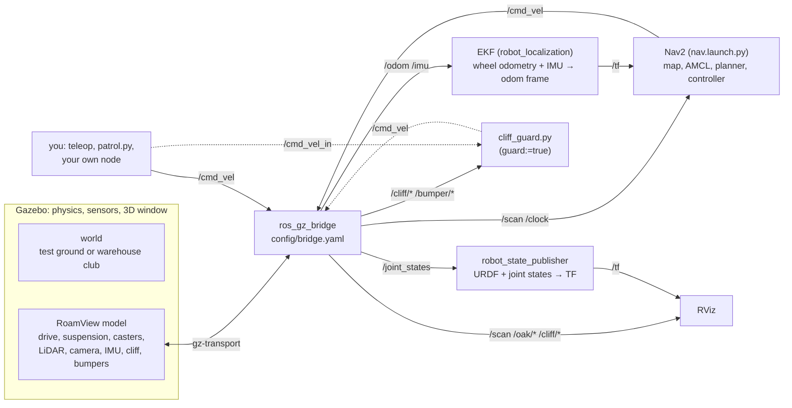
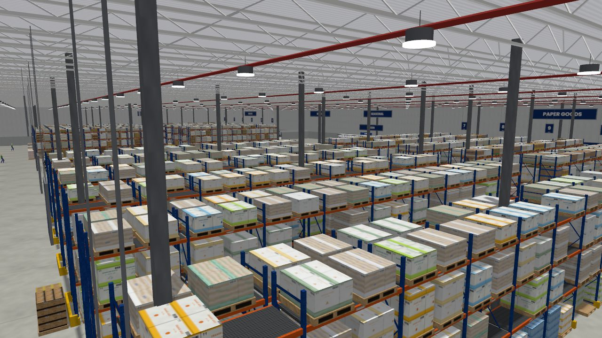
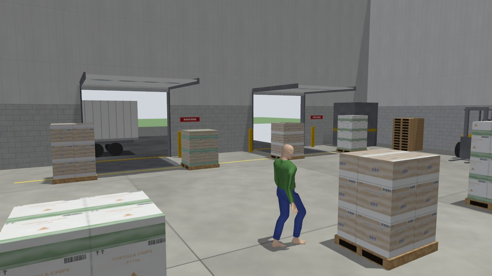
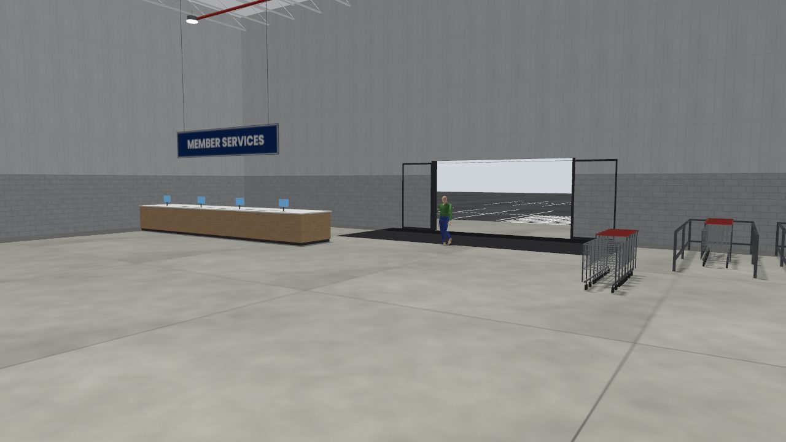
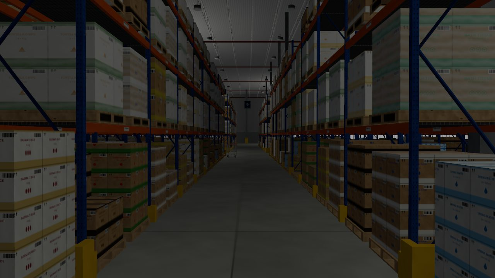
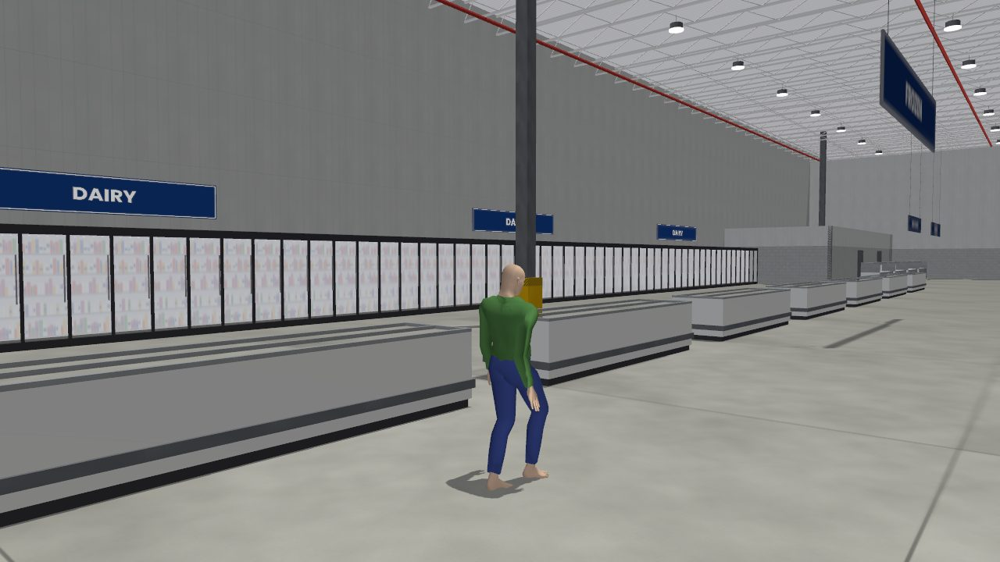
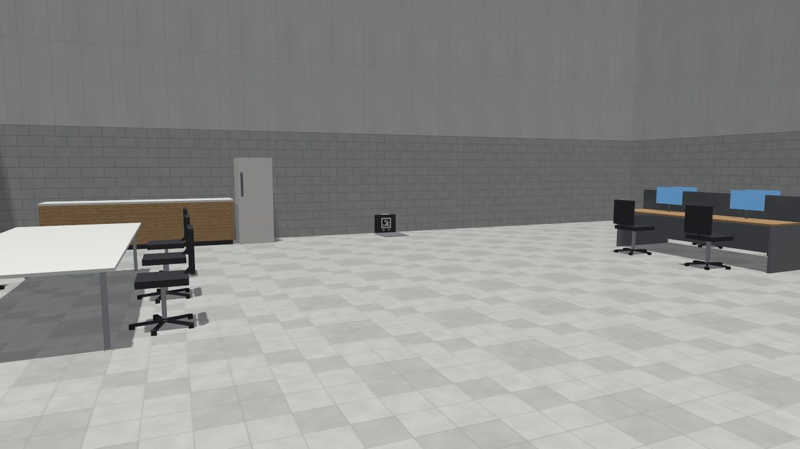
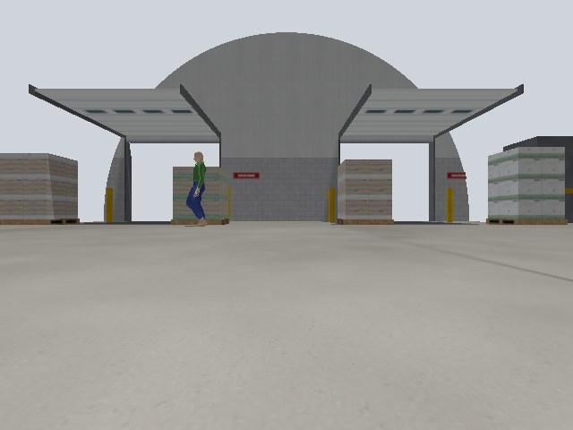

> [!WARNING]
> This markdown is written with Claude's help.

# RoamView ROS 2 workspace: simulation and dev container

This folder is RoamView's ROS 2 workspace. Today it holds one package, **`roamview_sim`**, which simulates the
robot (Rev B) in Gazebo so we can learn ROS 2 and test design rules before the hardware exists:

- a model of RoamView with its real dimensions, masses, sprung drive modules, casters, bumper and sensors
  (LiDAR, depth camera, IMU, four cliff sensors);
- two worlds: a two-room **test ground** with a stairwell drop, and a 130 × 100 m **warehouse club** with
  settings for lighting, walking shoppers and clutter;
- **Nav2** set up for the store: a map, no-go zones at the dock edges, a patrol route;
- tools that **check a running simulation** and **watch its memory**.

It also holds the team's **Docker dev container** (`Dockerfile`, `docker-compose.yml`), which can now run the
simulation too. You can work natively in WSL or in Docker; sections 4 and 5 walk through both.

**New to ROS?** Read section 2 first. It explains the dozen ideas the rest of this page uses, with RoamView as the
example.

## Contents

1. [What is in this folder](#1-what-is-in-this-folder)
2. [ROS 2 in five minutes](#2-ros-2-in-five-minutes)
3. [How the simulation fits together](#3-how-the-simulation-fits-together)
4. [Quick start A: native WSL](#4-quick-start-a-native-wsl)
5. [Quick start B: Docker](#5-quick-start-b-docker)
6. [Things to run](#6-things-to-run)
7. [Reference: arguments, topics, frames, files](#7-reference-arguments-topics-frames-files)
8. [Rendering on WSL](#8-rendering-on-wsl)
9. [Changing things](#9-changing-things)
10. [Test results](#10-test-results)
11. [What is approximate, and open issues](#11-what-is-approximate-and-open-issues)
12. [Troubleshooting](#12-troubleshooting)
13. [Versions, history and sources](#13-versions-history-and-sources)

## 1. What is in this folder

```text
hardware/ros/                    the ROS 2 workspace: colcon builds here, natively and in Docker
├── README.md                    this guide
├── Dockerfile                   two images: "base" (plain ROS 2 development) and "sim" (+ Gazebo, Nav2, RViz)
├── docker-compose.yml           two services: ros2 (base) and sim
├── docker-compose.wsl-gpu.yml   add-on for WSL: lets the sim container draw on your GPU
├── entrypoint.sh                sources ROS 2 when a container starts
├── .dockerignore                keeps build output out of image builds
├── .gitattributes               keeps Unix line endings (scripts with Windows line endings do not run)
└── src/                         ROS 2 packages, one folder each
    └── roamview_sim/            the simulation package (file map in section 7.6)
```

After a native build, `build/`, `install/` and `log/` appear next to `src/`. Git ignores them
(`hardware/.gitignore`).

## 2. ROS 2 in five minutes

ROS 2 (Robot Operating System) is not an operating system: it is a set of libraries and tools for writing a robot's
software as many small programs that talk to each other. The version here is **ROS 2 Lyrical Luth** (2026), on
Ubuntu 26.04.

- **Node**: one program doing one job. `robot_state_publisher` tells everyone where the robot's parts are,
  `cliff_guard.py` stops the robot at edges, and Nav2 is a dozen nodes.
- **Topic and message**: nodes talk by publishing messages on named topics, and any node can subscribe. The LiDAR's
  scans arrive on `/scan` as `sensor_msgs/LaserScan` messages. Speed commands go on `/cmd_vel` as
  `geometry_msgs/TwistStamped`. Look at them with `ros2 topic list`, `ros2 topic echo /scan` and
  `ros2 topic hz /scan`.
- **Package**: a folder with a `package.xml` (its name, version and what it needs) and its code. `roamview_sim` is
  one.
- **Workspace and colcon**: a folder whose `src/` holds packages (here, `hardware/ros`). `colcon build` builds them
  into `install/`, and `source install/setup.bash` makes them visible to `ros2` in that terminal. With
  `--symlink-install`, edits to Python, launch and config files take effect without rebuilding; new files still need
  a build.
- **Launch file**: a Python file that starts several nodes with their settings in one go.
  `ros2 launch roamview_sim sim.launch.py world:=warehouse_club` sets the launch argument `world`.
- **Parameter**: a setting of one node, given at start (`--ros-args -p speed:=0.3`) or changed while it runs
  (`ros2 param set /cliff_guard max_forward 0.2`).
- **URDF and xacro**: the robot description, in XML. It lists links (rigid parts) and joints (wheels, suspension arms,
  caster swivels), with shapes, masses, and the sensors and plugins Gazebo needs. xacro is a macro language that
  generates the URDF; `urdf/roamview.urdf.xacro` is the entry point.
- **TF**: the tree of coordinate frames (`map`, `odom`, `base_footprint`, `lidar_link`, ...) and how they move against
  each other, so any node can ask "where is the LiDAR, in map coordinates, right now?". Section 3 shows RoamView's
  tree.
- **Simulated time**: Gazebo publishes its own clock on `/clock`. Nodes started with `use_sim_time:=true` follow it
  instead of the wall clock, so a simulation running at half speed still gives the right answers, only slower.
- **Gazebo**: the simulator: physics, sensors and a 3D window. It has its own messaging (gz-transport), separate from
  ROS, so **ros_gz_bridge** copies the topics we choose across (`config/bridge.yaml`). Gazebo **Jetty** is the
  version paired with Lyrical.
- **RViz**: ROS's viewer. It shows what the robot *believes* (scans, frames, map, planned path), while Gazebo shows
  what is *really* there.
- **Nav2**: the navigation stack. A map server loads the map; **AMCL** works out where the robot is by matching scans
  to the map; a planner draws a path on the map; a controller follows it while avoiding what the LiDAR sees; and
  costmaps say where it is safe to drive. You give it a goal; it publishes `/cmd_vel`.

Two commands help whenever something is unclear: `ros2 node list` (what is running) and `ros2 topic info -v /scan`
(who publishes and who listens).

## 3. How the simulation fits together



Gazebo simulates the robot and its sensors; everything outside the Gazebo box is an ordinary ROS 2 node that would
run the same way on the real robot. The dotted path is used with `guard:=true`: you then send speeds to
`/cmd_vel_in` and `cliff_guard.py` passes them on (or stops them) to `/cmd_vel`.

**What `ros2 launch roamview_sim sim.launch.py` does, in order:**

1. Reads its arguments (section 7.1) and picks the renderers. On WSL it draws the window with `ogre` on the GPU and
   the sensors with `ogre2` in software (section 8).
2. For the warehouse club, runs `club_world.py`, which writes a world file into `~/.ros/roamview_sim/` from your
   settings (lighting, shoppers, clutter...). The heavy meshes are shared, so changing a setting costs nothing.
3. Runs xacro on `urdf/roamview.urdf.xacro` with the robot arguments (CoG, speed limits, camera on/off...), and starts
   `robot_state_publisher` with the result. It publishes the URDF on `/robot_description` and the frames of all
   the robot's parts on `/tf`.
4. Starts Gazebo with the world: one process, or two (server and window) on WSL.
5. Spawns the robot into Gazebo from `/robot_description` (`ros_gz_sim create`).
6. Starts `ros_gz_bridge` with `config/bridge.yaml`, so Gazebo's sensors and clock appear as ROS topics, and
   `/cmd_vel` reaches Gazebo's DiffDrive plugin, which plays the motor firmware.
7. Starts the EKF (`ekf:=true`, the default), RViz (`rviz:=true`) and `cliff_guard.py` (`guard:=true`).

`nav.launch.py` is separate: it adds Nav2 on top of a running simulation (section 6.3).

**Frames (TF).** REP 103 axes: x forward, y left, z up.

```text
map ──(AMCL, only with Nav2)──▶ odom ──(EKF)──▶ base_footprint ──▶ base_link ──▶ lidar_link
                                                 floor, under       axle line,     camera_link ──▶ camera_optical_frame
                                                 the axle           62.5 mm up     imu_link, cliff_*_link,
                                                                                   arms, wheels, casters, bumper halves
```

`odom → base_footprint` is where odometry says the robot has gone (smooth, but it drifts). `map → odom` is AMCL's
correction from matching scans to the map, so `map → base_footprint` is the best estimate of where the robot really
is. Gazebo's true pose is published separately on `/ground_truth/odom`, for testing only: a real robot has no such
topic.

## 4. Quick start A: native WSL

This is how the simulation was developed and tested: Windows 11, WSL2 with Ubuntu 26.04, ROS 2 Lyrical installed
in Ubuntu. Windows 11's WSL includes WSLg, which shows Linux windows (Gazebo, RViz) on the Windows desktop. Plain
Ubuntu 26.04 on a PC works the same way; skip the WSL-only lines.

### 4.1 One-time setup

**Ubuntu in WSL.** In PowerShell: `wsl --install -d Ubuntu-26.04` (`wsl --list --online` shows the exact names),
then open "Ubuntu" from the Start menu. Every command below runs in that Ubuntu terminal.

**ROS 2 Lyrical** (from the official "Ubuntu (deb packages)" instructions; if a line fails, see
[docs.ros.org](https://docs.ros.org/en/lyrical/Installation/Ubuntu-Install-Debs.html) for the current version):

```bash
sudo apt update && sudo apt install -y locales software-properties-common curl
sudo locale-gen en_US en_US.UTF-8 && sudo update-locale LC_ALL=en_US.UTF-8 LANG=en_US.UTF-8
sudo add-apt-repository -y universe
export ROS_APT_SOURCE_VERSION=$(curl -s https://api.github.com/repos/ros-infrastructure/ros-apt-source/releases/latest | grep -F "tag_name" | awk -F\" '{print $4}')
curl -L -o /tmp/ros2-apt-source.deb "https://github.com/ros-infrastructure/ros-apt-source/releases/download/${ROS_APT_SOURCE_VERSION}/ros2-apt-source_${ROS_APT_SOURCE_VERSION}.$(. /etc/os-release && echo $VERSION_CODENAME)_all.deb"
sudo dpkg -i /tmp/ros2-apt-source.deb
sudo apt update && sudo apt upgrade -y
sudo apt install -y ros-lyrical-desktop ros-dev-tools mesa-utils
echo "source /opt/ros/lyrical/setup.bash" >> ~/.bashrc && source ~/.bashrc
```

**GPU for the Gazebo window (WSL only).** Out of the box, Mesa (Linux's OpenGL) in WSL draws on the CPU. These lines
send it to your GPU through WSL's D3D12 driver:

```bash
echo 'export GALLIUM_DRIVER=d3d12' >> ~/.bashrc
echo 'export MESA_D3D12_DEFAULT_ADAPTER_NAME=NVIDIA' >> ~/.bashrc   # only if the laptop has two GPUs: use the NVIDIA one
source ~/.bashrc
glxinfo -B | grep -i renderer     # should name D3D12 and your GPU, not "llvmpipe"
```

### 4.2 Get the code and build

```bash
cd ~ && git clone https://github.com/Capstone-Performative-Entrepreneurs/RoamView.git
cd ~/RoamView/hardware/ros
sudo rosdep init                                 # once per machine ("already initialized" is fine)
rosdep update
rosdep install --from-paths src --ignore-src -y  # installs what package.xml lists: Gazebo, ros_gz, Nav2, ...
colcon build --symlink-install
source install/setup.bash
echo "source ~/RoamView/hardware/ros/install/setup.bash" >> ~/.bashrc
```

- **Clone inside Ubuntu's own file system** (`~`), not on `/mnt/c` or in OneDrive: builds there are slow and
  colcon's symlinks misbehave. If your clone lives on the Windows side, clone again in WSL, or copy
  `src/roamview_sim` into `~/roamview_ws/src` and build in `~/roamview_ws`.
- **After `git pull`:** run `colcon build --symlink-install` again if files were added or renamed, and
  `rosdep install ...` again if a `package.xml` changed. Edits to existing Python, launch, URDF and config files
  need nothing.

### 4.3 Run it

```bash
# terminal 1: the store with 8 shoppers (the first start takes a minute or two)
ros2 launch roamview_sim sim.launch.py world:=warehouse_club people:=8

# terminal 2: drive with the keyboard (i forward, , back, j / l turn, k stop)
ros2 run teleop_twist_keyboard teleop_twist_keyboard --ros-args -p stamped:=true

# terminal 3: is everything healthy?
ros2 run roamview_sim sim_check.py
```

You should see the Gazebo window with RoamView in the office next to its charging dock, and RViz with the LiDAR
scan (red points). **Nothing moves on its own**: the robot waits for commands, and the store has shoppers only when
you ask for them (`people:=8`). The very first start also downloads the shoppers' walking animation from Gazebo
Fuel (internet needed once). `ros2 launch roamview_sim sim.launch.py` alone opens the smaller test ground.

### 4.4 What a healthy check looks like

`sim_check.py` watches the running simulation for five seconds and prints one line per check (example from the
warehouse club; your numbers will differ):

```text
RoamView sim check (ROS_DOMAIN_ID=0)
PASS  clock   real-time factor 0.98
PASS  lidar   9.9 Hz, 450 beams, 368 hits, nearest 1.51 m
PASS  cliff   floor 0.085-0.088 m below (mounted 0.087 m up)
PASS  camera  640 x 480 rgb8, 15.0 Hz
PASS  odom    50 Hz
5 passed, 0 warnings, 0 failed
```

The **real-time factor** is how fast simulated time runs against the wall clock,
$\mathrm{RTF} = \Delta t_\mathrm{sim} / \Delta t_\mathrm{wall}$: 1.0 is real time, 0.5 is half speed. Add `--drive` to
also drive 0.4 m forward and back, and `--map` (warehouse club) to compare the LiDAR with the map. Section 6.4
explains every line and what to do when one fails.

## 5. Quick start B: Docker

Docker runs the simulation in a container: an isolated Ubuntu 26.04 with ROS 2, Gazebo and Nav2 already installed,
so nothing ROS-related goes onto your own system. The packages in `src/` are not copied into the image: they are
**mounted**, so you edit them with your usual editor and the container sees the change at once.

> The `sim` service is new (2026-10-04) and has not yet been run end to end on a team PC. If a step below fails,
> section 12 lists what to check, and the native setup (section 4) is the tested path.

### 5.1 What you need

- **Windows:** Docker Desktop with the WSL 2 engine, and *Settings → Resources → WSL integration* switched on for
  your Ubuntu distro. Run every command below in an **Ubuntu (WSL) terminal**, not PowerShell: that is where the
  display (`DISPLAY`, WSLg) and the GPU device the container borrows live.
- **Linux:** Docker Engine with the compose plugin, and an X server (your desktop). Run `xhost +local:docker` once per
  session so containers may open windows, and skip the `COMPOSE_FILE` line below (it is WSL-only).

The repository can be anywhere, including a OneDrive clone: nothing is built on the mounted folder (build output goes
to Docker volumes). A clone inside Ubuntu (`~/RoamView`) loads faster.

### 5.2 Build the image (once, and again when a `package.xml` changes)

```bash
cd ~/RoamView/hardware/ros                                        # wherever your clone is
export COMPOSE_FILE=docker-compose.yml:docker-compose.wsl-gpu.yml # WSL: let the container use your GPU
export MESA_D3D12_DEFAULT_ADAPTER_NAME=NVIDIA                     # WSL, laptops with two GPUs only
docker compose build sim
```

The first build downloads the `ros:lyrical-ros-base` image and several GB of packages, and takes 10–20 minutes;
later builds reuse Docker's cache. To stop typing the `export` lines, put them (without `export`) in a file named
`.env` in this folder; Docker Compose reads it, and git ignores it:

```text
COMPOSE_FILE=docker-compose.yml:docker-compose.wsl-gpu.yml
MESA_D3D12_DEFAULT_ADAPTER_NAME=NVIDIA
```

### 5.3 Start the container, build, run

```bash
docker compose up -d sim             # starts the container in the background, named roamview_sim
docker exec -it roamview_sim bash    # a shell inside it; ROS is already sourced
```

Inside the container (the prompt shows `root@...:/root/ros2_ws#`):

```bash
colcon build --symlink-install       # first time, and after adding files
source install/setup.bash
ros2 launch roamview_sim sim.launch.py world:=warehouse_club people:=8
```

Every further terminal is another `docker exec -it roamview_sim bash` on the host, for example:

```bash
ros2 run teleop_twist_keyboard teleop_twist_keyboard --ros-args -p stamped:=true
ros2 run roamview_sim sim_check.py
```

Is the window using your GPU? `docker exec roamview_sim glxinfo -B | grep -i renderer` names D3D12 and your GPU when
it is, and `llvmpipe` when everything draws in software (it still works, more slowly; see section 12).

### 5.4 Day to day

| You want to | Command (on the host, in `hardware/ros`) |
|---|---|
| Stop or restart the container | `docker compose stop sim`, `docker compose start sim` |
| Remove it (your build is kept in volumes) | `docker compose down` |
| Remove it and its volumes (next start needs a fresh `colcon build`) | `docker compose down -v` |
| Pick up changes to `docker-compose*.yml` | `docker compose up -d --force-recreate sim` |
| Pick up a changed `package.xml` | `docker compose build sim`, then `docker compose up -d --force-recreate sim` |

Edits to files in `src/` need neither: they are mounted. New files need a `colcon build` inside the container.

### 5.5 What the Docker files do

- **`Dockerfile`** has two images. `base` is the team's original dev container: `ros:lyrical-ros-base` plus colcon,
  rosdep and compilers (`INSTALL_DESKTOP=true` adds the ROS desktop). `sim` builds on `base` and runs `rosdep install`
  on the `package.xml` of every package in `src/`, which for `roamview_sim` means Gazebo Jetty, ros_gz, Nav2,
  robot_localization, RViz and teleop. Only the `package.xml` files reach that step, so editing code never
  invalidates the big install layer. It also sources ROS in every shell, and makes Qt windows use X11
  (`QT_QPA_PLATFORM=xcb`), because RViz cannot draw on WSLg's Wayland.
- **`docker-compose.yml`** defines the two services. `sim` mounts `src/` and the X11 socket (for windows), keeps
  colcon's `build/`, `install/` and `log/` in named volumes so they survive restarts, keeps Gazebo's download cache
  (`~/.gz`) in a volume too, and uses the host's network.
- **`docker-compose.wsl-gpu.yml`** adds WSL's GPU to the `sim` service: the `/dev/dxg` device, the driver libraries
  in `/usr/lib/wsl`, and `GALLIUM_DRIVER=d3d12`, following
  [Microsoft's WSLg container sample](https://github.com/microsoft/wslg/blob/main/samples/container/Containers.md).
  It works with any GPU brand, because it goes through Windows' own D3D12 driver.
- **`entrypoint.sh`** sources ROS (and the workspace once it is built) for the container's main process.

The container recognises WSL the same way a native install does (it runs on WSL's kernel), so section 8's renderer
choice applies inside it too.

### 5.6 The plain dev container (`ros2` service)

For ROS 2 work that needs no simulator, the original small image is unchanged:

```bash
docker compose build ros2        # add --build-arg INSTALL_DESKTOP=true for RViz and the demo nodes
docker compose run --rm ros2     # a shell in /root/ros2_ws with ROS sourced and src/ mounted
```

Inside, `colcon build --symlink-install` builds `src/`, and `entrypoint.sh` sources `install/setup.bash` on the next
start. To check the install with two nodes talking, keep one container running and open two shells in it:
`docker compose up -d ros2`, then in each terminal `docker exec -it ros2_lyrical bash` and
`source /opt/ros/lyrical/setup.bash`, and run `ros2 run demo_nodes_cpp talker` in one and
`ros2 run demo_nodes_py listener` in the other (the demo nodes come with the desktop variant). GUI apps also need the
desktop variant and a display: on Linux run `xhost +local:docker` first; on Windows start them from a WSL terminal,
and WSLg shows the windows.

## 6. Things to run

Every command in this section runs in a terminal where the workspace is sourced (native), or inside the container
(Docker). Start the simulation in one terminal and run the rest in others.

### 6.1 The test ground: braking and cliffs

Two 8 × 6 m rooms joined by a 0.9 m doorway, with a table (the LiDAR sees only its legs), a cabinet, a bin, a 70 mm
box below the LiDAR plane (only the bumper finds it), a 12 mm threshold strip, and a **0.6 m stairwell drop** at
x 2.4–3.4 m, y −3.0 to −1.8 m for cliff tests. The robot starts at (−2, 0) facing +x.

```bash
# stopping distance on open floor (simulation running)
ros2 run roamview_sim brake_test.py --ros-args -p use_sim_time:=true -p speed:=0.3

# cliff stop at the stairwell: spawn 0.8 m from the edge, facing it, with the cliff guard on
ros2 launch roamview_sim sim.launch.py x:=2.9 y:=-1.0 yaw:=-1.5708 guard:=true
ros2 run roamview_sim brake_test.py --ros-args -p use_sim_time:=true -p mode:=edge -p speed:=0.3
```

`brake_test.py` measures from Gazebo's ground truth: the stopping distance, peak deceleration and pitch, and (in
`mode:=edge`) how far the axle travelled after the first cliff reading and whether the robot fell. On flat floor the
stopping distance should match $d = \frac{v^2}{2a}$: at 0.3 m/s and 0.5 m/s², 90 mm. Section 10 has the results so
far.

### 6.2 The warehouse club

A generic, unbranded warehouse club at real scale: 130 × 100 m inside, 11 m to the roof deck, polished concrete.
Origin at the south-west inside corner, x east, y north. Plan to scale:
[`src/roamview_sim/docs/warehouse_club_plan.png`](src/roamview_sim/docs/warehouse_club_plan.png).

| | |
|---|---|
|  |  |
|  |  |
|  |  |

- **Sales floor:** 12 back-to-back rows of 5.5 m pallet racking (2.7 m bays, 3.6 m aisles), sales pallets on the
  floor, wrapped overstock above, endcap pallets, 100 display tables, front and back racetrack aisles (6 m), a 4 m
  cross aisle, hanging aisle and department signs.
- **Front:** 14 checkout lanes, food court, membership desk, cart corrals, an entrance with a 12 mm rubber mat, the
  exit, and the parking lot outside.
- **Back:** glass-door dairy fridges, freezer chests, meat and bakery cases, a prep room, an office and break room
  with RoamView's **charging dock** (AprilTag tag36h11 id 0, 200 mm, centre 250 mm up, facing east), and
  **receiving**, with a forklift, pallets and **two open dock doors: a 1.22 m drop** to the truck court.
- **Hazards** (`hazards:=true`): a pallet jack with its forks down (75 mm, under the LiDAR plane), an empty pallet
  (144 mm, the same), a wet-floor sign, and an abandoned cart (the LiDAR sees only its four thin posts). Everywhere:
  glass fridge doors, 25 m aisles that look alike, and table tops above the LiDAR plane.

Starting points (`spawn:=`): `dock` (1.6, 92.0, facing east, the default), `entrance` (115.0, 6.0, facing north),
`receiving` (119.0, 90.0, facing north).

```bash
ros2 launch roamview_sim sim.launch.py world:=warehouse_club
ros2 launch roamview_sim sim.launch.py world:=warehouse_club lighting:=night people:=20 clutter:=high seed:=4
ros2 launch roamview_sim sim.launch.py world:=warehouse_club spawn:=receiving guard:=true   # try the dock edge
```

The settings (lighting, people, clutter, hazards, seed, real-time factor) are in section 7.1. The same world
generator works without the launch file, for plain `gz sim`:

```bash
ros2 run roamview_sim club_world.py --lighting dim --people 12 --clutter 25 --seed 3 -o ~/club.sdf
GZ_SIM_RESOURCE_PATH=$(ros2 pkg prefix roamview_sim)/share/roamview_sim/models gz sim ~/club.sdf
```

Shoppers are Gazebo *actors*: they walk scripted loops, the LiDAR and cameras see them, but they have no collision,
so they walk through the robot and the bumper never touches one.

### 6.3 Navigation with Nav2, and the patrol

```bash
# terminal 1: the simulation, without RViz (Nav2 opens its own)
ros2 launch roamview_sim sim.launch.py world:=warehouse_club rviz:=false
# terminal 2: map + AMCL + planner + controller + keepout zones, localised at the same spawn preset
ros2 launch roamview_sim nav.launch.py
# terminal 3: patrol the store (all 28 waypoints, or a slice)
ros2 run roamview_sim patrol.py --ros-args -p use_sim_time:=true
ros2 run roamview_sim patrol.py --ros-args -p use_sim_time:=true -p first:=0 -p last:=6
```

In Nav2's RViz, the **2D Goal Pose** button sends the robot anywhere you click. If you start the simulation at
another preset, give `nav.launch.py` the same one (`spawn:=receiving`), so AMCL starts in the right place.

- **The map** (`maps/warehouse_club.pgm`) is not made by SLAM. The store generator slices every mesh at 256, 286 and
  316 mm (the LiDAR plane ± 30 mm) and draws what it cuts, so the map matches what the simulated LiDAR sees: 99–100 %
  of scan points within 10 cm of a map wall. You can still build your own with SLAM Toolbox and compare.
- **Keepout zones** (`maps/warehouse_club_keepout.pgm`) mark the two dock edges (2.4 m in front of each door, and
  beyond), both doorways, and everything outside the building. Nav2's KeepoutFilter makes them impassable, so no plan
  goes there. `keepout:=false` turns them off, to see why they are there.
- **Odometry:** Gazebo's wheel odometry gets turns wrong by about 3 % (a 180° turn reads 6° short), because the tyres
  never touch exactly at the track width. The EKF (`config/ekf.yaml`) takes the heading from the IMU's gyro and the
  speed from the wheels: after 10 m out, a U-turn and 10 m back it is 2 cm off, against 107 cm with wheels alone.
- **AMCL settings** (`config/nav2_warehouse_club.yaml`): the map is exact, so the laser model trusts hits more
  (`sigma_hit 0.1`, `z_hit 0.8`, `z_rand 0.2`), and the EKF is good, so the particle cloud spreads less
  (`alpha1`–`alpha4` 0.08 / 0.03 / 0.05 / 0.03). With Nav2's defaults the cloud spreads along the look-alike aisles
  and AMCL can settle in the wrong one. The endcap pallets are placed at random for the same reason: without them the
  store looks the same turned round, and AMCL cannot tell the two halves apart.
- **Nav2 version:** `nav.launch.py` merges our changes over the `nav2_params.yaml` of the Nav2 you have installed, so
  it follows Nav2's own parameter changes between releases.

### 6.4 Health checks

**`sim_check.py`** (start the simulation first):

```bash
ros2 run roamview_sim sim_check.py                  # watches only; the robot is not moved
ros2 run roamview_sim sim_check.py --drive          # also drives 0.4 m forward and back
ros2 run roamview_sim sim_check.py --map --drive    # warehouse club: also the LiDAR against the map
ros2 run roamview_sim sim_check.py --drive --topic /cmd_vel_in   # when the cliff guard is on
```

| Line | PASS means | If it fails |
|---|---|---|
| `clock` | `/clock` advances; shows the real-time factor | Paused (press play in Gazebo) or still loading; WARN below 0.5 = the PC is struggling (section 12) |
| `lidar` | about 10 scans per simulated second, with real hits | All beams at the minimum range = broken render path (section 8); none = no robot or no bridge (launch log) |
| `cliff` | the four sensors see the floor about 87 mm down | WARN = a drop under one (robot at an edge?); minimum range = broken render path |
| `camera` | `/oak/image` at about 15 Hz and not one flat colour | WARN with `camera:=false` is expected |
| `odom` | wheel odometry arrives (50 Hz) | Missing = DiffDrive plugin or bridge not running |
| `map` | ≥ 90 % of LiDAR hits fall on obstacles in the map | Shoppers and clutter in view lower it; far lower = world and map disagree |
| `drive` | 0.2 m/s for 2 s moves about 0.4 m, then back | Barely moved: wrong topic (`--topic /cmd_vel_in` with `guard:=true`) or the guard is stopping it |

It exits with code 1 if anything failed, so scripts can use it. All checks use simulated time, so they give the same
answer on a slow PC.

**`watch_memory.sh`** prints the memory of the Gazebo server, the Gazebo window and RViz every few seconds, with the
change since the line before, and how much memory is left. Keep it open in a spare terminal when you try new
renderer settings:

```bash
ros2 run roamview_sim watch_memory.sh          # every 5 s, warns above 6000 MB per process
ros2 run roamview_sim watch_memory.sh 2 4000   # every 2 s, warns above 4000 MB
```

While the world loads the numbers jump; after that they should stay near +0. A renderer that leaks shows a + on every
line. Stop the simulation (Ctrl+C in its terminal) long before memory runs out: on WSL that freezes every window.

## 7. Reference: arguments, topics, frames, files

### 7.1 `sim.launch.py` arguments

`ros2 launch roamview_sim sim.launch.py --show-args` prints the same list.

| Argument | Default | Meaning |
|---|---|---|
| `world` | `roamview_test` | `roamview_test`, `warehouse_club`, or the path to any SDF world |
| `gui`, `rviz` | `true` | Open the Gazebo window / RViz |
| `guard` | `false` | Start `cliff_guard.py`; then send commands to `/cmd_vel_in` |
| `spawn` | `dock` | Warehouse club start: `dock` (charging dock in the office), `entrance`, `receiving` |
| `x`, `y`, `yaw` | empty | Spawn pose (m, rad); empty = the world's default (test ground −2, 0, 0) or the `spawn` preset |
| `ekf` | `true` | Fuse wheel speed with the IMU gyro (robot_localization) for `odom → base_footprint`; `false` = wheels only |
| `camera` | `true` | Simulate the OAK-D Pro W (turn it off when the PC struggles) |
| `suspension` | `true` | Sprung trailing-arm drive modules; `false` bolts the wheels to the chassis |
| `caster_mode` | `swivel` | Real swivel casters (20 mm trail) or `ball` (frictionless) |
| `cog_x`, `cog_z` | `-0.004`, `0.126` | Whole-robot centre of gravity: m ahead of the axle, and height. Try `cog_x:=-0.016` |
| `max_speed`, `accel`, `decel` | `0.5`, `0.5`, `0.5` | What the motor firmware allows (m/s, m/s²) |
| `render_engine` | `auto` | Engine of the Gazebo window: `ogre` on WSL, `ogre2` elsewhere (section 8) |
| `sensor_rendering` | `auto` | Where the robot's camera, LiDAR and cliff sensors render (always `ogre2`): `software` on WSL, `gpu` elsewhere |

Warehouse club settings (`world:=warehouse_club` only):

| Argument | Default | Meaning |
|---|---|---|
| `lighting` | `day` | `day`, `bright`, `dim` (every other row of lights off), `night` (store closed: emergency lights, fridges) |
| `shadows` | `true` | `false` renders faster |
| `people` | `0` | Shoppers walking loops, 0–40 (`true` = 8). The first 8 follow hand-made routes, the rest random loops |
| `clutter` | `none` | Loose items next to the shelves: `none`, `low` (15), `medium` (40), `high` (90) or a number |
| `seed` | `1` | Same seed = same shopper loops and clutter, so a test can be repeated exactly |
| `hazards` | `true` | The four test hazards: pallet jack, empty pallet, wet-floor sign, abandoned cart |
| `rtf` | `1.0` | Real-time factor Gazebo aims for; lower it (e.g. `0.5`) if the PC cannot keep up, and Nav2 behaves better |

### 7.2 `nav.launch.py` arguments

| Argument | Default | Meaning |
|---|---|---|
| `map` | `maps/warehouse_club.yaml` | Occupancy map |
| `params_file` | `config/nav2_warehouse_club.yaml` | Our Nav2 settings |
| `merge_defaults` | `true` | Merge `params_file` over your Nav2's own `nav2_params.yaml` (`false` = use it alone) |
| `spawn` | `dock` | Where AMCL starts: `dock`, `entrance`, `receiving` (match the simulation) |
| `x`, `y`, `yaw` | empty | Initial pose instead of the preset |
| `keepout`, `keepout_mask` | `true`, `maps/warehouse_club_keepout.yaml` | Use the keepout zones, and which mask |
| `rviz` | `true` | Open RViz with Nav2's tools |

### 7.3 Nodes and tools in the package

| Run with `ros2 run roamview_sim ...` | What it does | Parameters / options |
|---|---|---|
| `cliff_guard.py` | Stand-in for the ESP32 cliff stop: `/cmd_vel_in` → `/cmd_vel`, blocks forward motion when a front cliff sensor reads a drop or a bumper touches, blocks reverse on a rear drop, caps speed, and stops after 0.5 s without commands. Started by `guard:=true`. | `floor_range` 0.087 m, `cliff_margin` 0.030 m, `max_forward` 0.3 m/s, `max_reverse` 0.1 m/s, `timeout` 0.5 s, `rate` 50 Hz |
| `brake_test.py` | Drives, stops and measures from ground truth (section 6.1) | `mode` `stop` or `edge`, `speed` 0.3, `cruise` 1.0 s, `timeout` 20 s, `cmd_topic` |
| `patrol.py` | Sends Nav2 through the waypoints of `config/warehouse_club_patrol.yaml` and reports each | `loops` 1 (0 = forever), `first`, `last`, `start` (preset to give AMCL first), `waypoints` |
| `club_world.py` | Writes a warehouse club world file from settings (the launch file runs it for you) | `--lighting --shadows --people --clutter --seed --hazards --rtf -o FILE` |
| `sim_check.py` | Health check of a running simulation (section 6.4) | `--drive`, `--map`, `--topic`, `--wait` |
| `watch_memory.sh` | Memory of Gazebo and RViz over time (section 6.4) | `[seconds between] [warning limit MB]` |

Parameters go after `--ros-args`, e.g. `ros2 run roamview_sim brake_test.py --ros-args -p use_sim_time:=true -p speed:=0.2`.
Always add `-p use_sim_time:=true` to nodes you start by hand next to the simulation.

### 7.4 Topics

| Topic | Type | From |
|---|---|---|
| `/cmd_vel` | `geometry_msgs/TwistStamped` | you, teleop, Nav2 or `cliff_guard` → Gazebo's DiffDrive (plays the motor firmware) |
| `/cmd_vel_in` | `geometry_msgs/TwistStamped` | you → `cliff_guard` (only with `guard:=true`) |
| `/odom` | `nav_msgs/Odometry` | DiffDrive wheel odometry, 50 Hz |
| `/odometry/filtered`, `/tf` (`odom → base_footprint`) | `nav_msgs/Odometry`, `tf2_msgs/TFMessage` | robot_localization EKF (wheels + IMU yaw rate), 50 Hz; with `ekf:=false` the transform comes from the wheels |
| `/joint_states` | `sensor_msgs/JointState` | wheels, suspension arms, caster swivels |
| `/scan` | `sensor_msgs/LaserScan` | the D500 LiDAR: 450 points, 360°, 10 Hz, 0.03–12 m, plane 286 mm up |
| `/imu` | `sensor_msgs/Imu` | the BNO086 in the OAK-D, 100 Hz |
| `/cliff/front_left`, `/cliff/front_right`, `/cliff/rear_left`, `/cliff/rear_right` | `sensor_msgs/LaserScan` (3 rays) | VL53L4CD time-of-flight sensors, 50 Hz; ≈ 0.087 m over flat floor |
| `/bumper/left`, `/bumper/right` | `ros_gz_interfaces/Contacts` | bumper halves; Gazebo publishes only while a half touches something |
| `/oak/image`, `/oak/depth_image`, `/oak/points`, `/oak/camera_info` | image types | OAK-D Pro W colour and depth, 640 × 480, 15 Hz, frame `camera_link` (x forward) |
| `/ground_truth/odom` | `nav_msgs/Odometry` | where the robot really is (simulator only, for tests) |
| `/clock` | `rosgraph_msgs/Clock` | Gazebo's simulated time |
| `/robot_description` | `std_msgs/String` | the URDF, from `robot_state_publisher` |

Gazebo's own topics (before the bridge) are listed by `gz topic -l`. To make another one visible in ROS, add an
entry to `config/bridge.yaml` (section 9).

### 7.5 Frames

See the tree in section 3. The sensors' frames are `lidar_link`, `camera_link` (and `camera_optical_frame`),
`imu_link` and `cliff_front_left_link` and so on; Gazebo stamps each sensor message with its frame, so RViz and Nav2
place the data correctly. `ros2 run tf2_tools view_frames` writes the live tree to a PDF.

### 7.6 Files in the package (`src/roamview_sim/`)

| Path | What it is |
|---|---|
| `package.xml`, `CMakeLists.txt` | Package manifest (name, version, dependencies) and build/install rules |
| `launch/sim.launch.py` | Starts Gazebo, the robot, the bridge, robot_state_publisher, the EKF, RViz and (optionally) the cliff guard |
| `launch/nav.launch.py` | Nav2 for the warehouse club: map server, AMCL, planner, controller, keepout filter, RViz |
| `urdf/roamview.urdf.xacro` | The robot: links, joints, masses, suspension springs, swivel casters, bumper halves, sensor frames |
| `urdf/roamview_gazebo.xacro` | Gazebo plugins and sensors: DiffDrive, joint states, ground truth, LiDAR, IMU, 4 cliff sensors, OAK-D Pro W |
| `urdf/roamview_body.xacro` | The visible shapes, generated from the CAD model by `tools/gen_body_xacro.py` (do not edit by hand) |
| `worlds/roamview_test.sdf` | The test ground, generated by `tools/gen_world.py` |
| `worlds/warehouse_club.sdf`, `worlds/warehouse_club_people.sdf` | Ready-made club worlds for plain `gz sim` (the launch file writes its own from your settings) |
| `models/warehouse_club/` | The store: glTF meshes (`meshes/*.gltf` + `*.bin`), textures, `model.sdf`, `manifest.json` |
| `maps/warehouse_club.{pgm,yaml}` | Nav2 map of the store, cut from the meshes at the LiDAR's height |
| `maps/warehouse_club_keepout.{pgm,yaml}` | Nav2 keepout mask: dock edges, doorways, outside the building |
| `config/bridge.yaml` | Which Gazebo topics cross into ROS 2, with their ROS names and types |
| `config/ekf.yaml` | robot_localization EKF: wheel speed + IMU yaw rate → `odom → base_footprint` |
| `config/nav2_warehouse_club.yaml` | Our Nav2 changes, merged over your Nav2's defaults by `nav.launch.py` |
| `config/warehouse_club_patrol.yaml` | Patrol waypoints and the spawn presets |
| `rviz/roamview.rviz` | The RViz view: robot, LiDAR, cliff rays, odometry, map, camera (off) |
| `scripts/` | The nodes and tools of section 7.3 |
| `tools/gen_body_xacro.py`, `tools/gen_world.py` | Generators for the robot's shapes and the test ground |
| `tools/warehouse_club/` | The store generator: layout, geometry, textures, map, keepout, walk routes (`build_club.py`) |
| `docs/` | The store plan and renders used in this guide |
| `.gitignore` | Keeps the mesh buffers (`*.bin`) in git, which `hardware/.gitignore` would otherwise drop as firmware |

## 8. Rendering on WSL

Gazebo draws twice: the **window** you look at, and the robot's **sensors** (camera, depth, LiDAR and cliff rays
are all rendered images in Gazebo). Under WSL, Linux reaches the GPU only through Mesa's D3D12 driver, and Gazebo's
two render engines behave differently on it. Measured on an RTX 5060 laptop (Lyrical + Jetty 10.5, warehouse club,
2026-10-01):

| Renderer | Gazebo window | Robot sensors |
|---|---|---|
| `ogre2` on the GPU | leaks about 150 MB/s: WSL runs out of memory within minutes and everything freezes | leaks about 20 MB/s |
| `ogre` on the GPU | stable at about 0.85 GB; a flatter look than `ogre2` | camera fine, but the LiDAR and cliff sensors read their minimum range on every beam |
| software (Mesa llvmpipe) | stable, but slow for a whole store | correct; `ogre2` sensors keep real time on about 3 CPU cores |

So on WSL, `sim.launch.py` draws the **window with `ogre` on the GPU** and renders the **sensors with `ogre2` in
software**. That takes two Gazebo processes: the server (physics and sensors, started with
`LIBGL_ALWAYS_SOFTWARE=1 GALLIUM_DRIVER=llvmpipe`) and the window, which joins it. Off WSL it stays one process with
`ogre2` on the GPU. The launch log says which it chose:

```text
[INFO] [launch.user]: WSL: the Gazebo window draws with ogre on your GPU; the robot sensors render with ogre2 in software ...
```

Other mixes are there for experiments: `render_engine:=ogre2` (the window on `ogre2`) and `sensor_rendering:=gpu`
(the sensors on the GPU). On WSL, run `watch_memory.sh` next to them. Detection reads `/proc/sys/kernel/osrelease`,
which names Microsoft's kernel on WSL, also inside a Docker container on WSL.

## 9. Changing things

| To change | Edit | Then |
|---|---|---|
| Robot speed limits, CoG, camera on/off | launch arguments (section 7.1), or their defaults in `urdf/roamview.urdf.xacro` | nothing (`--symlink-install`) |
| Masses, inertia, springs, motor torque, tyre friction | `urdf/roamview.urdf.xacro` | relaunch |
| Sensor rates, ranges, noise, mounting | `urdf/roamview_gazebo.xacro` (and the frames in `roamview.urdf.xacro`) | relaunch |
| The robot's visible shapes after a CAD change | `old-designs/Interconnect_RevB/model_b.py`, then `python3 tools/gen_body_xacro.py "<path to old-designs/Interconnect_RevB>"` | relaunch |
| Which Gazebo topics reach ROS | `config/bridge.yaml` (`gz topic -l` lists Gazebo's names) | relaunch |
| Nav2 behaviour | `config/nav2_warehouse_club.yaml` (only what differs from Nav2's defaults) | relaunch `nav.launch.py` |
| Patrol route | `config/warehouse_club_patrol.yaml` | rerun `patrol.py` |
| The store's layout or look | `tools/warehouse_club/club_layout.py` (and `club_props.py`, `club_textures.py`), then `python3 tools/warehouse_club/build_club.py` (about 15 s; options `--stock full\|normal\|sparse`, `--seed N`) | relaunch; this rewrites `models/warehouse_club/`, `maps/`, the patrol and both ready-made worlds |
| The test ground | `tools/gen_world.py`, then `python3 tools/gen_world.py` | relaunch |
| A node of your own | a new file in `scripts/`, listed in `CMakeLists.txt` under `install(PROGRAMS ...)`, plus its dependencies in `package.xml` | `colcon build --symlink-install` (and `rosdep install ...` natively, or `docker compose build sim`, for new dependencies) |
| A new package | a new folder in `src/` (`ros2 pkg create --build-type ament_python my_pkg` inside `src/`) | the same |

The generators in `tools/` are run by hand and need Python libraries that the simulation itself does not:
`sudo apt install python3-numpy python3-pil python3-opencv python3-shapely python3-matplotlib`. The robot numbers
come from the earlier Rev B design files in `old-designs/Interconnect_RevB/` (`model_b.py` and `cog_b.py`). That folder
is kept locally at the repository root and is not tracked by git; the current robot CAD is in `hardware/RobotCAD/`.

## 10. Test results

### On WSL (Lyrical + Jetty 10.5, RTX 5060, 28 threads, 2026-10-01)

`ros2 launch roamview_sim sim.launch.py world:=warehouse_club people:=8 spawn:=receiving`, with the Gazebo window and
RViz open:

| Check | Result |
|---|---|
| Memory over 4 min | flat: server 1.21 GB, Gazebo window 0.86 GB, RViz 0.29 GB (with `ogre2` on the GPU the window had grown past 5 GB within a minute) |
| Speed | 0.92 × real time with the window, RViz and 8 shoppers; 1.0 without the window. The sensors use about 3 CPU cores |
| LiDAR against the map | 99 % of hits within 0.2 m of a mapped obstacle (100 % with no shoppers) |
| Cliff sensors on the floor | 0.083–0.089 m (the sensors sit 87 mm up) |
| Shoppers | walk their loops; shopper 6 shows in the robot camera and changes 2–12 LiDAR beams a second as it passes, 124 as it walks through the robot's spot |
| Driving | 0.3 m/s for 4 s of wall time: 1.01 m; 0.8 rad/s for 2.5 s: 104° (both what 0.92 × real time gives) |



The robot camera draws only to 12 m, the OAK-D's depth range, so walls further away show as sky.

### Test ground (Jazzy + Harmonic, cloud machine, software rendering, 2026-09-28)

| Case | Result |
|---|---|
| Open floor, 0.3 m/s, 0.5 m/s² | stops in ≈ 100 mm ($v^2/2a$ = 90 mm) |
| Edge, Rev B CoG (4 mm behind the axle), 0.3 m/s, 0.5 m/s² | the front caster drops, the robot pitches forward during the stop and **falls in** |
| Edge, same, `decel:=0.25` | no early pitch, but it needs ≈ 180 mm to stop → the drive wheels go over, **falls in** |
| Edge, `cog_x:=-0.016` (≈ axle 12 mm forward), 0.3 m/s | stops 94 mm after the reading, 1.2° nose down, stays on the floor |
| Edge, Rev B CoG, 0.2 m/s | stops after 46 mm, caster drops, 1.2°, stays on the floor |
| Edge, Rev B CoG, 0.15 m/s | stops after 26 mm, caster stays on the floor |

This agrees with the hand calculation behind the open cliff-stop issue (`old-designs/DESIGN_RULES.md` §6). The Rev B
design is unchanged; these are what-ifs for the team to discuss.

### Warehouse club (Jazzy + Harmonic, cloud machine, 2 CPU cores, software rendering, 2026-09-30)

| Test | Settings | Result |
|---|---|---|
| Load, first `/scan` | `camera:=false gui:=false` | 10 s; runs at 0.71 × real time |
| LiDAR against the map | ground-truth pose, office and back racetrack | 100 % / 99 % of scan points within 10 cm of a map wall |
| Out 10 m, U-turn, back 10 m | `ekf:=false` (wheels only) | 107 cm off: the turn reads 6° short |
| Same | `ekf:=true` (default) | 2 cm off, heading within 0.1° |
| Plans into keepout zones | `nav.launch.py` | dock edge, beyond the dock door, entrance doorway: all refused; receiving 1.5 m short of the edge: 101.5 m path |
| Patrol waypoints 0–9 (≈ 200 m) | defaults, `rtf:=0.35` | all 10 reached; AMCL against ground truth: mean 22 cm, 95 % under 58 cm, worst 66 cm |
| Patrol waypoints 11–15 (≈ 90 m, into receiving to 4 m from the dock edge and back) | defaults, `rtf:=0.35` | all 5 reached; AMCL mean 14 cm, worst 42 cm |
| Same route as 0–9 with Nav2's default AMCL noise, before the endcaps | wheels only, and with the EKF | error grew to 1.2–1.4 m along the aisles, then AMCL jumped to a look-alike spot 15 m away |
| Dock edge, `guard:=true`, 1 m from door 1 | 0.15 m/s | stops 25 mm after the reading, caster stays on the floor |
| Same | 0.3 m/s | the caster and drive wheels go over: **falls 1.22 m** (the same cliff-stop issue) |
| Gazebo Jetty 10.5 | `worlds/warehouse_club_people.sdf` | loads, runs and renders with no errors |

The two-core cloud machine needed `rtf:=0.35` for Nav2; a laptop with more cores should not.

### Not yet tested

- The Docker `sim` service (section 5): written 2026-10-04, not yet run end to end on a team PC.
- `sim_check.py` and `watch_memory.sh` were run on the cloud machine (Jazzy + Harmonic): test ground and warehouse
  club, with and without the camera, with `--map` and `--drive`.

## 11. What is approximate, and open issues

- **Open issue, cliff stop:** at 0.3 m/s the robot can fall over an edge before it stops (section 10). The design is
  unchanged for now; moving the drive axle about 12 mm forward is the fix the tests point to.
- Masses and the CoG are estimates from `cog_b.py` (5.71 kg, CoG 126 mm up, 4 mm behind the axle); the chassis
  inertia comes from the part envelopes. Weigh the robot and update `mass`, `cog_x` and `cog_z`.
- The spring (2 N/mm at the wheel, 20 N preload), the gearmotor torque (2 N·m) and the tyre friction (μ 0.7) are
  placeholders.
- Collisions are simple boxes and cylinders; each cliff sensor is 3 rays, not an 18° cone.
- The DiffDrive plugin plays the ESP32's speed loop, and `cliff_guard.py` plays the ESP32's cliff stop, which on the
  real robot does not go through ROS.
- Warehouse club: shoppers have no collision; loose cartons, water bundles and wet-floor signs are light and can be
  pushed, while carts, pallets, ladders and jacks are fixed; the simulated LiDAR sees glass (fridge doors) as solid,
  where a real one partly sees through it; the lighting is a few directional and point lights plus glowing fixtures.
- The robot camera's picture ends at 12 m (its depth range), so distant walls show as sky.

## 12. Troubleshooting

**Running the simulation**

- **Nothing moves in Gazebo.** That is normal at first: the robot moves only when something publishes `/cmd_vel`
  (teleop, Nav2, `patrol.py`), and the store has shoppers only with `people:=N`. If instead the whole PC slows down
  and then WSL stops responding, a renderer is leaking memory: use the default `render_engine` and
  `sensor_rendering` (section 8) and watch with `watch_memory.sh`.
- **The robot does not move when I drive.** `/cmd_vel` is `TwistStamped`: use `-p stamped:=true` with teleop, and
  `geometry_msgs/msg/TwistStamped` with `ros2 topic pub`. With `guard:=true`, send to `/cmd_vel_in`. The teleop
  terminal must have the keyboard focus.
- **The LiDAR shows a ring of points stuck on the robot, or Nav2 sees obstacles everywhere (WSL).** The sensors are
  rendering with `ogre` on the GPU, where every beam reads its minimum range. Leave `sensor_rendering` at its default.
  `sim_check.py` reports this as a FAIL on `lidar` and `cliff`.
- **It is slow** (real-time factor well under 1): `shadows:=false camera:=false`, fewer `people`, or `rtf:=0.5`. The
  window costs as much as the sensors, so `gui:=false` with RViz is the lightest way to watch. On WSL the sensors
  render on the CPU, so `camera:=false` helps most there.
- **The Gazebo window is black or very slow (WSL).** `glxinfo -B | grep -i renderer` must name D3D12 and your GPU
  after the `~/.bashrc` lines of section 4.1 (that is the window; the sensors use llvmpipe on purpose).
- **The Gazebo window does not open, or closes at once (WSL).** Gazebo Jetty's window uses Qt 6; try
  `export QT_QPA_PLATFORM=xcb` and launch again.
- **RViz closes at once: "Unable to create the rendering window" (WSL).** RViz cannot draw on WSLg's Wayland. Both
  launch files start it with `QT_QPA_PLATFORM=xcb`; by hand, run `QT_QPA_PLATFORM=xcb rviz2`.
- **Nothing spawns, or the log repeats "Requesting list of world names".** Gazebo's server and the spawner cannot find
  each other: close every Gazebo window, `export GZ_IP=127.0.0.1` in each terminal, and relaunch.
- **`sim_check.py` says "no /clock".** The simulation is not running, or the two terminals use different
  `ROS_DOMAIN_ID`s (`echo $ROS_DOMAIN_ID` in both). In Docker, run it inside the same container.
- **No shoppers appear.** Their walking animation downloads from fuel.gazebosim.org the first time: check the internet
  connection, then look in `~/.gz/fuel/`.
- **Nav2 says "Timed out while waiting for action server".** The PC is busy: lower `rtf` in the simulation launch
  (`default_server_timeout` in `config/nav2_warehouse_club.yaml` helps too).
- **AMCL starts in the wrong place.** Give `nav.launch.py` the same `spawn` (or `x`, `y`, `yaw`) as the simulation.
- **"robot_localization is not installed"** in the launch log: run `rosdep install --from-paths src --ignore-src -y`
  again, or start with `ekf:=false` (wheel odometry only: turns drift, AMCL works harder).
- **Warnings "gz_frame_id / frame_id ... not defined in SDF".** Harmless: the model carries both tags, so it runs on
  Gazebo Jetty and Harmonic.
- **`gz sim` cannot find `model://warehouse_club/...`** (only when running a world by hand): the launch file sets
  `GZ_SIM_RESOURCE_PATH` for you; by hand,
  `export GZ_SIM_RESOURCE_PATH=$(ros2 pkg prefix roamview_sim)/share/roamview_sim/models`.

**Building**

- **`ros2 launch` says the package or a file is not found.** `source install/setup.bash` in this terminal (or add it
  to `~/.bashrc`), and after adding new files run `colcon build --symlink-install` again.
- **`rosdep install` cannot resolve a key.** Run `rosdep update` first; a key that still fails is a typo in a
  `package.xml` or a package not released for Lyrical yet.
- **A script fails with `$'\r': command not found`, `bad interpreter` or `exec format error`.** It has Windows line
  endings. `.gitattributes` prevents this for new checkouts; to fix a file in place, `sed -i 's/\r$//' FILE`. To
  refresh a whole checkout made before `.gitattributes` existed: commit or stash your changes, then
  `git rm --cached -r hardware/ros && git reset --hard` from the repository root (`reset --hard` discards uncommitted
  changes everywhere in the repository).

**Docker**

- **No window appears.** Start the container from a WSL terminal (on Windows), where `echo $DISPLAY` prints `:0`; on
  Linux, run `xhost +local:docker` first. After changing either, `docker compose up -d --force-recreate sim`.
- **The window works but is slow; `glxinfo -B` in the container says llvmpipe.** The GPU add-on is not active: check
  that `COMPOSE_FILE` (exported, or in `.env`) includes `docker-compose.wsl-gpu.yml` (`docker compose config` shows
  the merged result), then recreate the container. If it still says llvmpipe, GPU pass-through does not work on this setup: the simulation
  still runs, with the window drawn in software.
- **`docker compose build sim` fails at `rosdep install`.** Usually the network: retry. Read the last lines for a key
  rosdep cannot resolve.
- **The container exits at once, or `/entrypoint.sh: no such file or directory`.** `entrypoint.sh` has Windows line
  endings: see *Building* above, then rebuild the image.
- **Files created in `src/` from the container belong to root (Linux).** The container runs as root; `sudo chown -R
  $USER src` fixes them, or add a matching user to the Dockerfile.
- **Nodes in two different containers cannot see each other.** Both services use the host's network; on Docker
  Desktop that is the Docker VM's network. Running all the nodes in one container (with `docker exec`) always works.

## 13. Versions, history and sources

**Tested with:** ROS 2 Lyrical + Gazebo Jetty 10.5 on WSL2 Ubuntu 26.04 (RTX 5060); ROS 2 Jazzy + Gazebo Harmonic on
Ubuntu 24.04 (cloud machine, software rendering). The URDF carries both Jetty's and Harmonic's tag names for sensor
frames, so it runs on both.

**History**

- 0.1 (2026-09-28): the robot model, the test ground, the bridge, RViz, `cliff_guard.py`, `brake_test.py`.
- 0.2 (2026-09-30): the warehouse club with its settings, the Nav2 map, keepout zones and patrol, the EKF.
- 0.2.1 (2026-10-01): the renderer choice on WSL (section 8) and the RViz fix.
- 0.3.0 (2026-10-04): moved into this repository from the team OneDrive (`ENGR 490 - Capstone/ROS/roamview_sim`,
  which stays there at 0.2.1); `sim_check.py`, `watch_memory.sh`, the Docker `sim` service, this guide. Develop in
  this copy.

**Sources**

- [ROS 2 Lyrical documentation](https://docs.ros.org/en/lyrical/): installation, tutorials on nodes, topics, launch
  files, parameters, tf2
- [Gazebo: ROS 2 integration](https://gazebosim.org/docs/latest/ros2_integration/) and
  [ros_gz_bridge message types](https://github.com/gazebosim/ros_gz/blob/ros2/ros_gz_bridge/README.md)
- [Nav2 documentation](https://docs.nav2.org/), including the keepout filter and AMCL parameters
- [robot_localization documentation](https://docs.ros.org/en/ros2_packages/rolling/api/robot_localization/)
- [Microsoft's WSLg container sample](https://github.com/microsoft/wslg/blob/main/samples/container/Containers.md):
  GUI and GPU flags for containers on WSL
- [`ros` official Docker images](https://hub.docker.com/_/ros/tags)
- [REP 103](https://www.ros.org/reps/rep-0103.html) (units and axes) and [REP 105](https://www.ros.org/reps/rep-0105.html)
  (`map`, `odom`, `base_link` frames)
